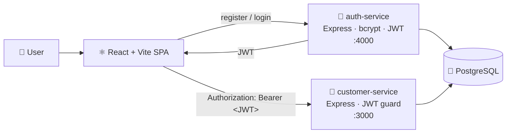
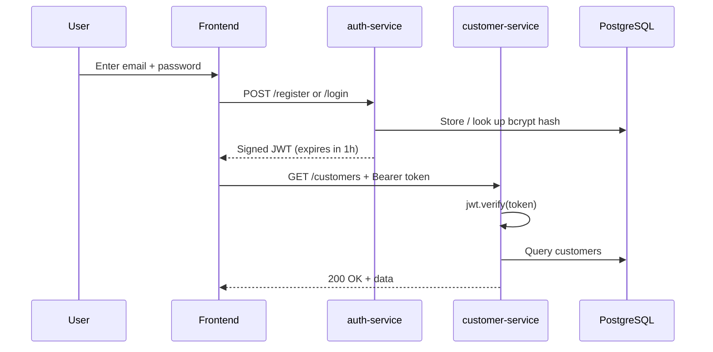

<p align="center">
  
</p>

<p align="center">
  
  
  
  
  
  
  
</p>

<p align="center">
  <b>A full-stack, microservices-based app that shows how real products handle sign-up, login and protected data,<br/>built with independently deployable services, hashed credentials and stateless token auth.</b>
</p>

---

## ✨ Highlights

- 🧩 **Two independent services:** authentication and customer data live in separate Express apps, each with its own Prisma schema and migrations
- 🔑 **Industry-standard credential storage:** passwords are hashed with **bcrypt** (10 salt rounds) and never stored or returned in plain text
- 🎟️ **Stateless sessions:** login issues a signed **JWT** (1-hour expiry) that every protected route verifies, so no server-side session store is needed
- 🛡️ **Protected CRUD:** the customer service rejects any request without a valid token
- ⚛️ **Typed React frontend:** a TypeScript + Vite + Tailwind SPA with login, register and full customer management pages
- ☁️ **Cloud-ready:** includes a `render.yaml` blueprint for deploying both services and a managed Postgres database to Render

---

## 🏗️ Architecture



| Service | Responsibility | Tech |
|---|---|---|
| **`auth-service/`** | Registration, login, password hashing, token issuing and `/me` identity lookup | Node.js, Express, TypeScript, Prisma, bcrypt, jsonwebtoken |
| **`customer-service/`** | Create, read, update and delete customer records behind JWT verification | Node.js, Express, TypeScript, Prisma |
| **`frontend/`** | SPA with auth pages, protected routes and customer list/create/edit views | React, TypeScript, Vite, Tailwind CSS, Axios |

---

## 🔄 Authentication Flow



---

## 📡 API Reference

<details>
<summary><b>auth-service</b> (default port <code>4000</code>)</summary>

| Method | Route | Description |
|---|---|---|
| `POST` | `/register` | Create an account; hashes the password and returns a JWT |
| `POST` | `/login` | Verify credentials with `bcrypt.compare` and return a JWT |
| `GET` | `/me` | Return the user behind the supplied token |

</details>

<details>
<summary><b>customer-service</b> (default port <code>3000</code>, all routes require a JWT)</summary>

| Method | Route | Description |
|---|---|---|
| `GET` | `/customers` | List all customers |
| `GET` | `/customers/:id` | Get one customer |
| `POST` | `/customers` | Create a customer |
| `PUT` | `/customers/:id` | Update a customer |
| `DELETE` | `/customers/:id` | Delete a customer |

</details>

### 🗃️ Data Models

```prisma
model User {                         model Customer {
  id           String   @id            id        String   @id
  email        String   @unique        name      String
  passwordHash String                  email     String   @unique
  createdAt    DateTime                phone     String?
}                                      createdAt DateTime
                                       updatedAt DateTime
                                     }
```

---

## 🚀 Getting Started

### Prerequisites
- [Node.js](https://nodejs.org/) 18+ and npm 9+
- [PostgreSQL](https://www.postgresql.org/) (local or hosted)

### 1. Clone and create the database
```bash
git clone https://github.com/JeevanJyot55/authEncryption.git
cd authEncryption
psql postgres -c "CREATE DATABASE authencryption_db;"
```

### 2. Configure environment variables
Create a `.env` file in **both** `auth-service/` and `customer-service/`:
```env
DATABASE_URL="postgresql://<user>:<password>@localhost:5432/authencryption_db"
JWT_SECRET="<a-long-random-string>"   # must be identical in both services
```
And `frontend/.env`:
```env
VITE_AUTH_URL="http://localhost:4000"
VITE_API_URL="http://localhost:3000"
```

### 3. Run the services (three terminals)
```bash
# Terminal 1: auth service
cd auth-service && npm install && npx prisma migrate dev && npm run dev

# Terminal 2: customer service
cd customer-service && npm install && npx prisma migrate dev && npm run dev

# Terminal 3: frontend
cd frontend && npm install && npm run dev
```
Open **http://localhost:5173**, register an account and start managing customers.

---

## 📁 Project Structure

```
authEncryption/
├── auth-service/          # Express + Prisma authentication API
│   ├── prisma/            # User schema + migrations
│   └── src/index.ts
├── customer-service/      # Express + Prisma protected CRUD API
│   ├── prisma/            # Customer schema + migrations
│   └── src/index.ts
├── frontend/              # React + TypeScript + Vite + Tailwind SPA
│   └── src/{pages,components,services}
└── render.yaml            # Render deployment blueprint
```

---

## 🗺️ Roadmap

- [ ] 🐳 Docker Compose for one-command local setup
- [ ] 🔁 Refresh tokens and token revocation
- [ ] 🔐 OAuth2 / Google Sign-In
- [ ] 👥 Role-based access control (RBAC)
- [ ] 🚦 Rate limiting on auth endpoints
- [ ] ☁️ Deploy to Google Cloud Run or AWS ECS
- [ ] 📊 Monitoring with Prometheus + Grafana

---

<p align="center">
  Built by <a href="https://github.com/JeevanJyot55"><b>Jeevan Jyot Singh</b></a> · <a href="https://www.linkedin.com/in/jeevanjyotsingh">LinkedIn</a> · <a href="https://jeevanjyot55.github.io">Portfolio</a>
</p>
